# AgendaNex

SaaS fullstack de agendamento online para pequenos negócios, com página pública de reservas, painel administrativo por empresa e área de gestão da plataforma.

> Este repositório apresenta o projeto AgendaNex para fins de portfólio e demonstração comercial.  
> O código-fonte principal é proprietário e permanece em um repositório privado.

## Demo online
🚀 Acessar AgendaNex = <a href="https://www.agendanex.com.br" target="_blank">
  Abrir AgendaNex
</a>
 
**API:** NestJS hospedada no Render e integrada ao frontend.

> Na primeira abertura, alguns serviços gratuitos podem levar alguns segundos para responder.

## Sobre o projeto

O AgendaNex foi desenvolvido para ajudar pequenos negócios a organizar seus agendamentos, profissionais, serviços, clientes e faturamento.

Cada negócio possui seu próprio ambiente, com dados isolados das demais empresas cadastradas na plataforma.

O projeto também foi criado como portfólio para demonstrar o desenvolvimento de uma aplicação fullstack real, envolvendo autenticação, autorização, regras de negócio, banco de dados, integrações externas e deploy em nuvem.

## Destaques técnicos

- SaaS multi-business com isolamento de dados por empresa;
- autenticação NextAuth + JWT;
- RBAC com OWNER, ADMIN e STAFF;
- reserva protegida contra conflitos e concorrência;
- disponibilidade baseada em profissional, serviço, duração, buffer e timezone;
- PostgreSQL + Prisma com migrations versionadas;
- armazenamento de imagens em Cloudflare R2;
- CI com GitHub Actions;
- testes automatizados no frontend e backend;
- deploy independente de frontend, backend e banco.

## Problema resolvido

Muitos pequenos negócios ainda controlam reservas por mensagens, anotações ou planilhas.

Isso pode causar:

- horários duplicados;
- demora no atendimento;
- dificuldade para organizar profissionais;
- falta de controle dos clientes;
- dificuldade para acompanhar o faturamento.

O AgendaNex centraliza essas informações em um único sistema.

## Principais funcionalidades

### Área pública

- página personalizada para cada negócio;
- perfil público com informações do estabelecimento;
- endereço e localização;
- horário de funcionamento;
- indicação de estabelecimento aberto ou fechado;
- botão "Como chegar";
- escolha de serviço;
- escolha de profissional compatível com o serviço;
- opção de qualquer profissional com atribuição automática;
- seleção de data e horário disponível;
- criação de agendamento;
- consulta segura de reservas;
- cancelamento online;
- contato por WhatsApp;
- funcionamento adaptado ao fuso horário do negócio.

### Painel administrativo

- dashboard com resumo da operação;
- gerenciamento de serviços;
- gerenciamento de profissionais;
- associação entre profissionais e serviços;
- agenda com filtros por período, status e funcionário;
- Modo Foco para operação da agenda diária;
- visualização diária organizada por profissional;
- reagendamento de atendimentos;
- atribuição de profissionais;
- bloqueio de horários;
- visualização de conflitos;
- gerenciamento de clientes;
- controle de faltas;
- identificação de clientes próximos ou atrasados para retorno;
- reativação manual de clientes pelo WhatsApp;
- mensagens de confirmação e lembrete pelo WhatsApp;
- endereço do estabelecimento nas mensagens quando disponível;
- relatório de faturamento;
- controle de atendimentos agendados, concluídos, cancelados e não comparecimentos.

  
### Administração da plataforma

- painel exclusivo para Admin Master;
- gerenciamento de negócios;
- criação de novos negócios e proprietários;
- controle de planos;
- controle de período de teste;
- controle de vencimento e assinatura;
- busca, filtros e paginação;
- acompanhamento geral da plataforma.

## Tecnologias utilizadas

### Frontend

- Next.js
- React
- TypeScript
- Tailwind CSS
- TanStack Query
- React Hook Form
- Zod
- Axios
- NextAuth

### Backend

- NestJS
- TypeScript
- Prisma ORM
- PostgreSQL
- JWT
- Luxon

### Infraestrutura e integrações

- Vercel
- Render
- Supabase PostgreSQL
- Cloudflare R2
- Resend / SMTP
- GitHub Actions
- Docker Compose
- npm workspaces

## Arquitetura

O projeto utiliza uma arquitetura de monorepo com separação entre frontend e backend.

```text
Frontend Next.js
       |
       | Axios / HTTP
       v
Backend NestJS
       |
       | Prisma ORM
       v
PostgreSQL / Supabase
```

No backend, o fluxo principal segue:

```text
Controller -> Service -> Repository -> Prisma -> PostgreSQL
```

O frontend não acessa o banco de dados diretamente. Toda comunicação é feita por meio da API NestJS.

## Autenticação e autorização

O fluxo de autenticação funciona da seguinte forma:

1. O usuário informa suas credenciais no frontend.
2. O NextAuth envia os dados para o backend NestJS.
3. O backend valida o usuário e gera um token JWT.
4. O frontend mantém a sessão autenticada.
5. As requisições protegidas enviam o token para a API.
6. O backend valida a identidade e as permissões do usuário.

Os principais perfis são:

- `OWNER`: proprietário do negócio;
- `ADMIN`: administrador da operação;
- `STAFF`: funcionário ou profissional;
- `ADMIN MASTER`: administrador da plataforma.

## Principais desafios técnicos

- isolamento de dados entre diferentes negócios;
- arquitetura multi-business;
- autenticação com NextAuth e JWT;
- autorização baseada no vínculo do usuário com o negócio;
- prevenção de reservas duplicadas;
- controle de conflitos de horários;
- disponibilidade por profissional;
- bloqueios gerais ou individuais;
- tratamento de fuso horário;
- recuperação de senha por e-mail;
- proteção de rotas públicas e administrativas;
- deploy separado de frontend, backend e banco de dados.

## Regras de negócio importantes

- todos os dados administrativos são filtrados pelo negócio selecionado;
- serviços inativos não aceitam novas reservas, mas permanecem no histórico;
- somente atendimentos concluídos entram no faturamento;
- cancelamentos e faltas não geram receita;
- bloqueios podem afetar todo o negócio ou apenas um profissional;
- a disponibilidade considera duração do serviço, intervalos e conflitos;
- clientes com faltas recorrentes podem ter restrição de reserva online;
- planos vencidos podem bloquear operações de escrita;
- consultas públicas retornam apenas os dados necessários.

## Decisões de engenharia

Durante o desenvolvimento do AgendaNex, algumas decisões técnicas foram importantes para manter segurança, consistência e escalabilidade da aplicação.

Entre elas:

- isolamento de dados entre diferentes empresas;
- revalidação de permissões no backend;
- controle de acesso baseado no vínculo do usuário com o negócio;
- prevenção de reservas concorrentes;
- vínculo entre profissionais e serviços;
- atribuição automática de profissional quando necessário;
- cálculo de disponibilidade considerando duração, buffer e bloqueios;
- tratamento de timezone por estabelecimento;
- preservação do histórico dos agendamentos;
- uso de migrations versionadas no PostgreSQL;
- separação entre frontend, API e persistência;
- respostas públicas contendo apenas os dados necessários;
- armazenamento externo de imagens por serviço S3-compatible.

## Qualidade e testes

O AgendaNex possui testes automatizados no frontend e backend cobrindo regras críticas da aplicação.

Entre os cenários testados estão:

- isolamento multi-business;
- autenticação e autorização;
- regras de acesso por perfil;
- criação e disponibilidade de agendamentos;
- conflitos de horários;
- buffer entre atendimentos;
- bloqueios de agenda;
- relação entre profissionais e serviços;
- fluxo de reserva pública;
- faturamento e descontos;
- funcionalidades administrativas;
- componentes e fluxos do frontend.

A integração contínua com GitHub Actions executa automaticamente:

- lint;
- typecheck;
- testes automatizados;
- build do backend;
- build do frontend.

## Screenshots

### Modo Foco da Agenda

Visão operacional da agenda diária, organizada por profissional e preparada para uso durante o atendimento.

Permite acompanhar rapidamente os horários do dia e executar ações como concluir, cancelar, registrar não comparecimento e entrar em contato com o cliente pelo WhatsApp.

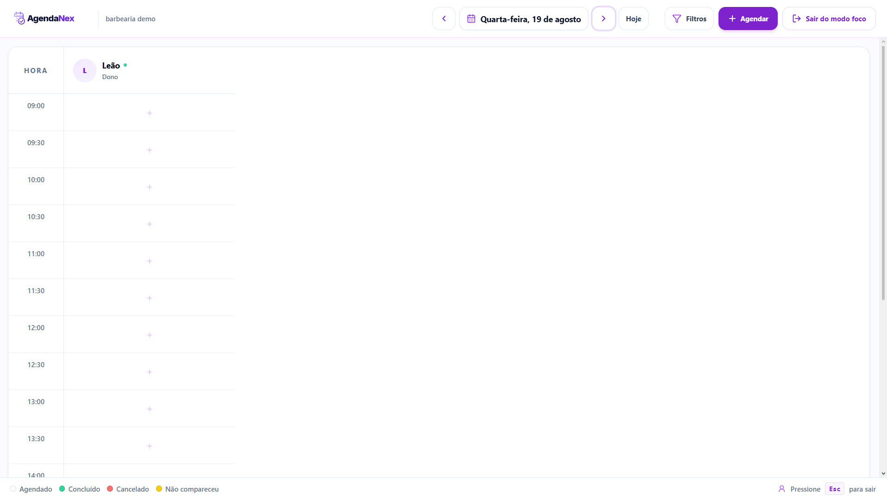

### Página inicial

Apresentação pública do AgendaNex, com acesso à demonstração e aos principais recursos da plataforma.

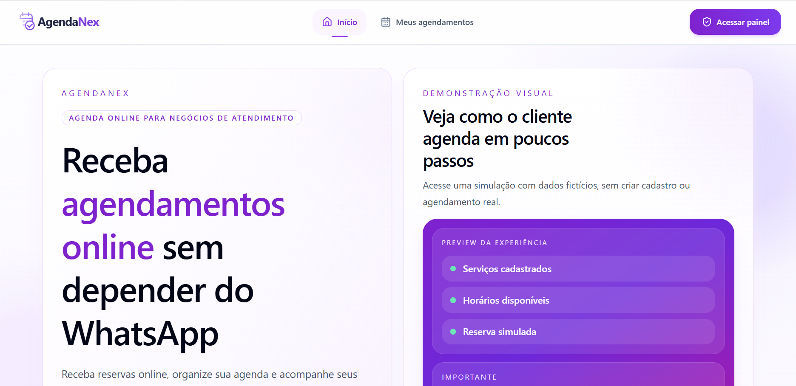

### Página pública do negócio

Apresentação do negócio, horário de funcionamento, serviços disponíveis e orientação para realizar uma reserva online.

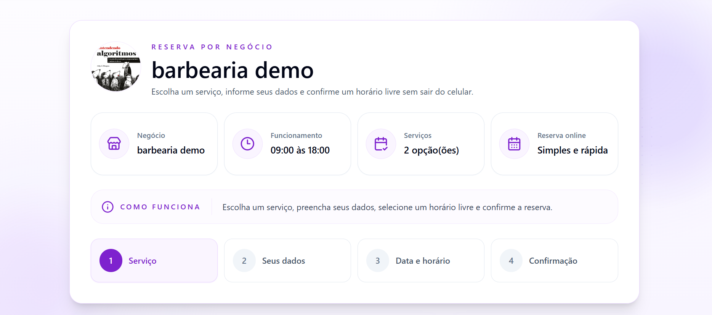

### Seleção de data e horário

Etapa do fluxo de reserva em que o cliente escolhe uma data e um dos horários disponíveis para o serviço selecionado.

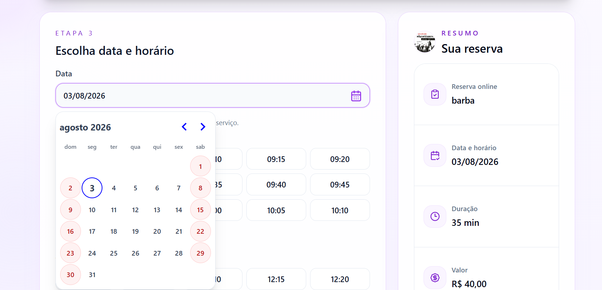

### Gestão do atendimento

Detalhes administrativos do agendamento, com informações do cliente, serviço, data, status, profissional responsável e opções de reagendamento.

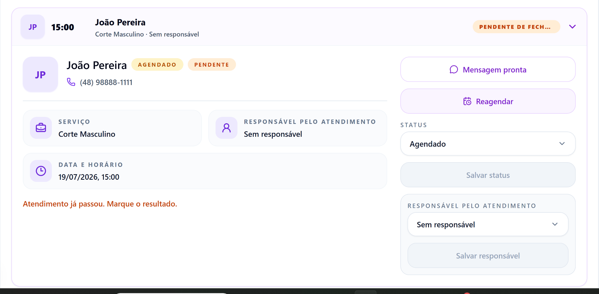

### Dashboard administrativo

Visão geral do negócio, com link público para reservas e resumo dos agendamentos por status.

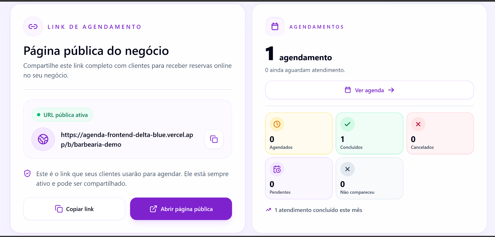

### Horários de funcionamento

Configuração dos dias e períodos em que o negócio aceita agendamentos.

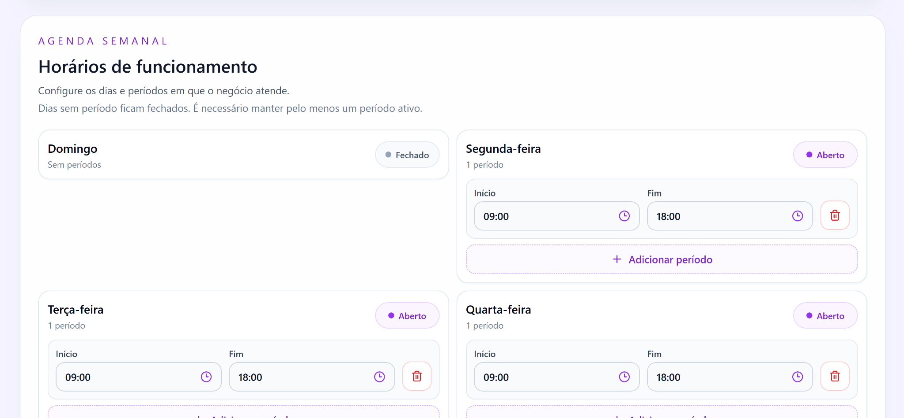

### Bloqueios de agenda

Controle dos períodos em que o negócio inteiro ou um profissional específico não estará disponível.

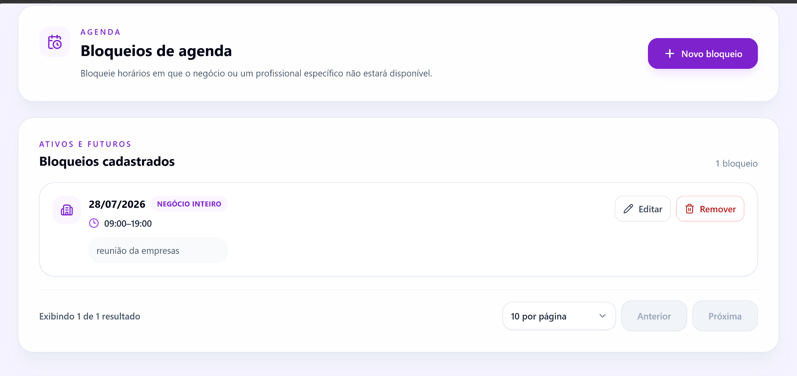

### Criação de bloqueio

Cadastro de bloqueio geral ou direcionado a um profissional, com data, horário e motivo.

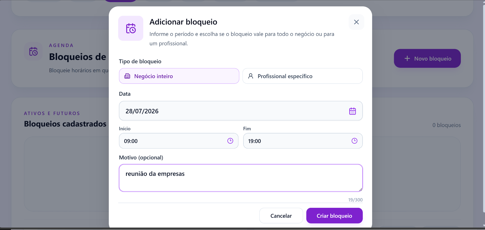

### Gestão financeira

Resumo mensal com faturamento, custos informados, lucro estimado e ticket médio.

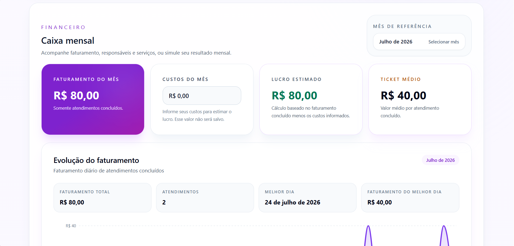

### Receita por serviço

Distribuição do faturamento entre os serviços concluídos no período selecionado.

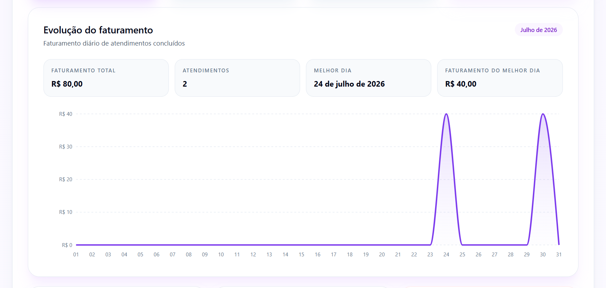

### Consulta pública de agendamentos

Área pública para o cliente consultar seus próximos agendamentos usando o telefone informado na reserva.

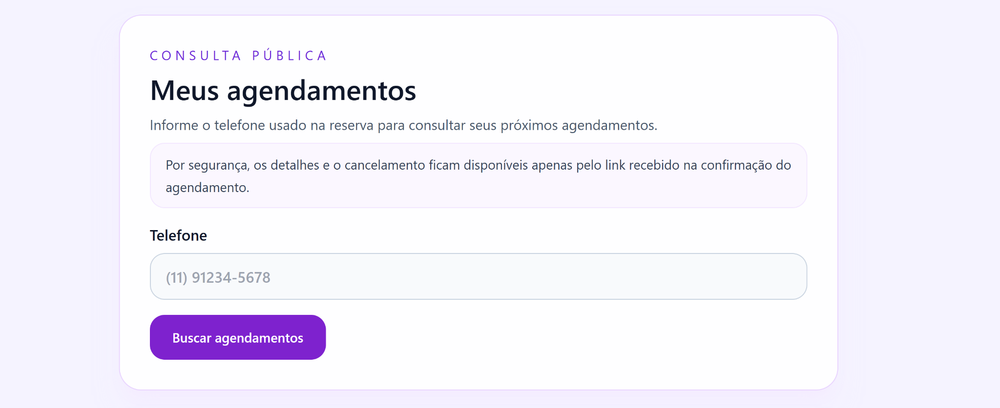

## Versão mobile

O AgendaNex possui interface responsiva para que clientes e administradores possam utilizar a plataforma pelo celular.


## Sobre o desenvolvimento

O AgendaNex foi desenvolvido como projeto de estudo profissional e produto SaaS real, permitindo aplicar na prática conceitos de frontend, backend, banco de dados, segurança, infraestrutura e regras de negócio.

Durante o desenvolvimento trabalhei com:

- interfaces responsivas utilizando React e Next.js;
- criação de APIs REST com NestJS;
- modelagem de dados com PostgreSQL e Prisma;
- autenticação e autorização;
- arquitetura multi-business;
- implementação de regras de negócio;
- testes automatizados;
- integração contínua com GitHub Actions;
- armazenamento de arquivos em cloud;
- deploy de frontend e backend;
- migrations em PostgreSQL;
- debugging de problemas em ambientes reais;
- evolução de funcionalidades baseada em cenários de uso reais.

## Objetivo profissional

Atualmente busco minha primeira oportunidade profissional na área de desenvolvimento de software, como **Desenvolvedor Full Stack Júnior, Desenvolvedor Front-End Júnior ou Estagiário em Desenvolvimento**.

Tenho interesse em ambientes onde eu possa continuar evoluindo tecnicamente, colaborar com outros desenvolvedores e participar do desenvolvimento de aplicações reais.

## Objetivo comercial

O AgendaNex também está sendo preparado para atender pequenos negócios que desejam organizar seus agendamentos e reduzir o trabalho manual.

A solução pode ser utilizada por:

- salões de beleza;
- barbearias;
- clínicas;
- estúdios;
- profissionais autônomos;
- prestadores de serviço;
- pequenos negócios que trabalham com horários marcados.

## Limitações atuais

- cobrança e renovação ainda são controladas manualmente;
- integração com gateway de pagamento ainda não foi implementada;
- notificações automáticas ainda são limitadas;
- relatórios avançados e exportações ainda estão em desenvolvimento;
- algumas telas ainda precisam de testes em diferentes dispositivos;
- observabilidade e monitoramento ainda estão sendo ampliados.

## Próximas melhorias

- confirmação e lembrete por WhatsApp ou e-mail;
- integração com gateway de pagamento;
- cobrança recorrente;
- confirmação e lembrete por WhatsApp ou e-mail;
- lista de espera;
- encaixes;
- sinal de reserva;
- políticas de cancelamento;
- cupons;
- programa de fidelidade;
- exportação de relatórios em CSV e PDF;
- resumo diário de agenda e faturamento;
- ampliação dos testes automatizados;
- melhorias de monitoramento e observabilidade.

## Status do projeto

O AgendaNex está em evolução e já possui os principais fluxos de um SaaS de agendamento implementados.

A etapa atual está focada em:

- homologação ponta a ponta;
- refinamento da experiência do usuário;
- testes em produção;
- melhoria da apresentação para portfólio;
- preparação para utilização por negócios reais.

## Contato

**Jaderson Farias**

Desenvolvedor Full Stack Júnior | Estudante de Análise e Desenvolvimento de Sistemas

📍 Santa Catarina, Brasil

- GitHub: [github.com/SEU-USUARIO](https://github.com/jadersonfarias)
- LinkedIn: [linkedin.com/in/SEU-LINKEDIN](https://www.linkedin.com/in/jaderson-farias/)
- E-mail: SEU_EMAIL
## Aviso de propriedade

O AgendaNex é um projeto proprietário.

Este repositório não contém o código-fonte principal da aplicação e não concede autorização para copiar, redistribuir, modificar ou comercializar o sistema, sua identidade visual ou sua implementação sem autorização.

O conteúdo deste repositório possui finalidade exclusivamente demonstrativa.
